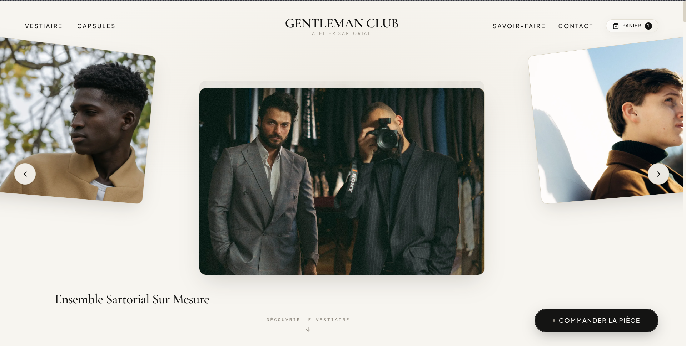

# GENTLEMAN CLUB — Atelier Sartorial & Haute Confection

A **premium, immersive menswear e-commerce experience** built with React, Tailwind CSS, and TypeScript, featuring a 3D interactive hero, an orbiting product catalogue, scroll-driven animations, and a fully responsive layout designed for mobile, tablet, and desktop.

---

## Features

- Interactive 3D hero wheel showcasing nine signature looks, with drag, trackpad, keyboard, and arrow navigation, and a quick "Commander la Pièce" shortcut to the active look
- Orbiting 3D product catalogue (Halo Reel) with auto-play, drag rotation, category filters, and live product name and price at its center
- Touch-first snap carousel replacing the 3D orbit on mobile and tablet, with swipe, arrows, and a position counter
- Scroll-synced dual-row marquee ("Le Mouvement Sartorial") moving in opposite directions, driven directly through the DOM for flicker-free scrolling on iOS
- "Savoir-Faire" craftsmanship section with a sticky desktop panel, oversized step numbers, and detailed tailoring specifications per standard
- "Le Cercle Privé" staggered testimonial cards with two-finger horizontal swipe and animated background numerals
- "Les Capsules" scroll-driven stacking cards, each opening a detailed capsule modal with materials, finishes, and editorial lookbook
- Product detail side drawer with size selection, technical specifications, and tailoring details
- Persistent shopping cart drawer (saved in localStorage) with quantity controls, free-shipping progress bar, privilege promo codes, and order totals
- Private appointment booking modal for bespoke and private orders
- Luxury editorial design with warm alabaster, taupe, and obsidian palette, chrome-metallic badges, and serif display typography
- Responsive architecture tuned for phones, tablets, and desktops, with a dedicated navigation, hero, and catalogue layout per breakpoint

---

## Technologies Used

- **React 19** – Component-based UI architecture and modern React hooks
- **TypeScript** – Strongly typed JavaScript for robust scalability and maintainable development
- **Vite 8** – Fast development server and optimized production builds
- **Tailwind CSS v4** – Utility-first styling with native CSS layers and design tokens
- **Framer Motion** – Scroll-linked animations, stacking cards, spring-based drawers, and modal transitions
- **Lucide React** – Clean, consistent icon set
- **React Context API** – Global cart state management with localStorage persistence
- **Custom Google Fonts** – Cormorant Garamond (Display), Plus Jakarta Sans (Body), and Kanit (Accents)
- **Optimized WebP assets** – Lightweight, high-quality imagery for fast loading

---

## Preview

